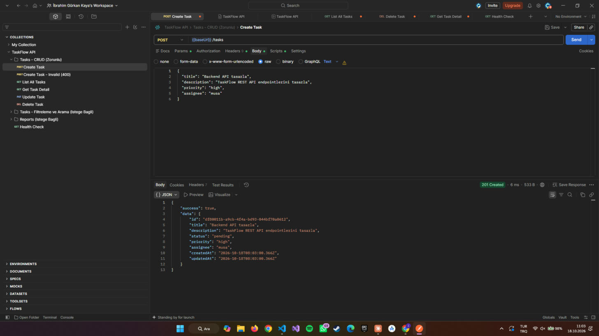
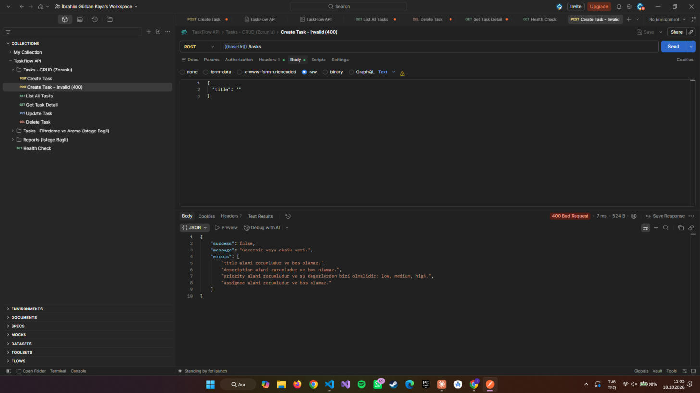

# TaskFlow API

Görev ve Proje Yönetim Sistemi — REST API Geliştirme Projesi
Node.js ile Backend Programlama — Bitirme Projesi

## İçindekiler

- [Proje Hakkında](#proje-hakkında)
- [Kullanılan Teknolojiler](#kullanılan-teknolojiler)
- [Kurulum](#kurulum)
- [Çalıştırma](#çalıştırma)
- [Proje Klasör Yapısı](#proje-klasör-yapısı)
- [API Endpointleri](#api-endpointleri)
- [Middleware'ler](#middlewareler)
- [Postman ile Test](#postman-ile-test)
- [Dokümanlar](#dokümanlar)

## Proje Hakkında

Bir yazılım şirketinin ekip içerisindeki görevleri, projeleri ve çalışanların
sorumluluklarını takip edebilmesi için geliştirilmiş, tamamen REST API
mantığında çalışan bir **Görev Yönetim Sistemi** API'sidir. Detaylı bilgi
için [docs/PROJE_TANITIMI.md](docs/PROJE_TANITIMI.md) dosyasına bakınız.

## Kullanılan Teknolojiler

- [Node.js](https://nodejs.org/) (v18+)
- [Express.js](https://expressjs.com/) 5
- Dosya tabanlı JSON veri deposu (`src/data/tasks.json`) — harici veritabanı gerektirmez
- [dotenv](https://www.npmjs.com/package/dotenv) — ortam değişkeni yönetimi
- [nodemon](https://www.npmjs.com/package/nodemon) — geliştirme ortamı (opsiyonel)

## Kurulum

1. Depoyu klonlayın:

   ```bash
   git clone <repo-url>
   cd TNC_Backend
   ```

2. Bağımlılıkları yükleyin:

   ```bash
   npm install
   ```

3. (Opsiyonel) `.env` dosyası oluşturun. Oluşturmazsanız uygulama
   varsayılan olarak `3000` portunda çalışır.

   ```bash
   cp .env.example .env
   ```

## Çalıştırma

```bash
# Üretim modu
npm start

# Geliştirme modu (dosya değişikliklerinde otomatik yeniden başlatır)
npm run dev
```

Sunucu ayağa kalktığında terminalde şu mesajı görürsünüz:

```
TaskFlow API http://localhost:3000 adresinde calisiyor.
```

Tarayıcıdan veya Postman'den `http://localhost:3000/` adresine istek
atarak API'nin çalıştığını doğrulayabilirsiniz.

## Proje Klasör Yapısı

```
TNC_Backend/
├── src/
│   ├── controllers/       # İş mantığı (task ve report controller'ları)
│   ├── data/               # JSON tabanlı veri deposu ve erişim katmanı
│   ├── middleware/         # logger, validation, error handler
│   ├── models/             # Task veri modeli
│   ├── routes/              # Express route tanımları
│   ├── app.js               # Express uygulaması ve middleware zinciri
│   └── server.js            # Uygulama giriş noktası
├── docs/                    # Proje dokümanları
├── postman/                 # Postman koleksiyonu
├── logs/                    # Logger tarafından üretilen istek kayıtları
├── package.json
└── README.md
```

## API Endpointleri

Tüm görev endpointleri `/tasks`, raporlama endpointleri `/reports` altında
sunulur. Ayrıntılı istek/cevap örnekleri için
[docs/API_TASARIM.md](docs/API_TASARIM.md) dosyasına bakınız.

### Zorunlu — CRUD

| Method | Endpoint      | Açıklama                  |
| ------ | ------------- | -------------------------- |
| POST   | `/tasks`      | Yeni görev oluşturur       |
| GET    | `/tasks`      | Tüm görevleri listeler     |
| GET    | `/tasks/:id`  | Görev detayını getirir     |
| PUT    | `/tasks/:id`  | Görevi günceller           |
| DELETE | `/tasks/:id`  | Görevi siler                |

### İsteğe Bağlı — Filtreleme / Arama / Sayfalama / Sıralama

| Method | Endpoint                          | Açıklama                          |
| ------ | ---------------------------------- | ---------------------------------- |
| GET    | `/tasks?status=completed`          | Duruma göre filtreler              |
| GET    | `/tasks?priority=high`             | Önceliğe göre filtreler            |
| GET    | `/tasks/search?keyword=backend`    | Başlık/açıklamada anahtar kelime arar |
| GET    | `/tasks/assignee/:name`            | Atanan kişiye göre listeler        |
| GET    | `/tasks?page=1&limit=10`           | Sayfalama                          |
| GET    | `/tasks?sort=createdAt` / `-createdAt` | Sıralama (artan / azalan)     |

### İsteğe Bağlı — Raporlama

| Method | Endpoint            | Açıklama                          |
| ------ | -------------------- | ---------------------------------- |
| GET    | `/reports/completed` | Tamamlanan görevleri listeler       |
| GET    | `/reports/pending`   | Bekleyen görevleri listeler          |
| GET    | `/reports/summary`   | Genel sistem özetini döndürür       |

## Middleware'ler

- **Logger** *(zorunlu)*: Her isteğin method, endpoint ve zaman damgasını
  hem konsola hem de `logs/requests.log` dosyasına kaydeder.
- **Validation** *(isteğe bağlı)*: Görev oluşturma/güncelleme isteklerinde
  `title`, `description`, `priority`, `assignee` alanlarını doğrular; geçersiz
  veya eksik veri durumunda açıklayıcı mesajla `400 Bad Request` döner.
- **Error Handler**: Tanımsız route'lar için `404`, beklenmeyen hatalar için
  `500` cevabı döner.

## Postman ile Test

`postman/TaskFlow.postman_collection.json` dosyasını Postman'e import
ederek tüm endpointleri hazır istekler ile test edebilirsiniz.

1. Postman'i açın → **Import** → `postman/TaskFlow.postman_collection.json`
2. Koleksiyondaki `baseUrl` değişkeni varsayılan olarak
   `http://localhost:3000` şeklindedir; sunucunuz farklı bir portta
   çalışıyorsa güncelleyin.
3. Sunucuyu `npm start` ile çalıştırın ve istekleri sırasıyla çalıştırın.

### Test Ekran Görüntüleri

**Create Task — başarılı (201 Created)**



**Create Task — geçersiz veri (400 Bad Request)**



## Dokümanlar

- [docs/PROJE_TANITIMI.md](docs/PROJE_TANITIMI.md) — Amaç, senaryo, sistem özeti
- [docs/VERI_MODELI.md](docs/VERI_MODELI.md) — Task veri yapısı
- [docs/API_TASARIM.md](docs/API_TASARIM.md) — Endpoint bazlı istek/cevap dokümantasyonu
- [docs/KULLANIM_KILAVUZU.md](docs/KULLANIM_KILAVUZU.md) — API'nin adım adım kullanımı
